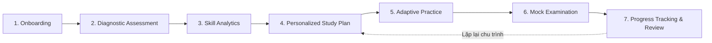

# NTMK REBUILD — KIẾN TRÚC NỀN TẢNG & QUYẾT ĐỊNH KỸ THUẬT (PHASE 01)
**Tài liệu:** `docs/rebuild/02-architecture.md`  
**Dự án:** NTMK — Nền tảng Ôn Tập Thông Minh  
**Trạng thái:** Được phê duyệt (Approved)  
**Phạm vi:** Kiến trúc tổng thể hệ thống, Chiến lược chuyển đổi từng bước, Design System & App Shell

---

## 1. TỔNG QUAN KIẾN TRÚC MỚI (TARGET ARCHITECTURE)

Dự án NTMK chuyển đổi từ một ứng dụng làm bài trắc nghiệm đơn lẻ thành một **Nền tảng Học tập Thông minh (Intelligent Learning Platform)** dành cho học sinh THPT Việt Nam (Lớp 10, 11, 12 và Luyện thi Tốt nghiệp THPT).

### Hành trình người dùng cốt lõi (Core Learning Journey):


---

## 2. QUYẾT ĐỊNH KIẾN TRÚC: CHUYỂN ĐỔI TỪNG BƯỚC (STRANGLER FIG PATTERN)

### 2.1. Đặt vấn đề
Audit chỉ ra rằng việc thay thế toàn bộ mã nguồn bằng React + TypeScript + Vite ngay trong Phase 01 mang lại rủi ro gián đoạn rất cao:
- Cấu hình Vercel hiện tại phục vụ tệp tĩnh trực tiếp từ `public/`.
- Hàng ngàn câu hỏi trắc nghiệm GDPT 2018 đang chạy tốt trên engine hiện hữu.
- Trang quản trị `admin.html` phụ thuộc vào các script Node/client hiện có.

### 2.2. Quyết định (Architecture Decision Record - ADR 001)
Chúng tôi áp dụng mô hình **Progressive Modular Architecture**:
1. **Giai đoạn 1 (Phase 01 - Hiện tại)**:
   - Chuẩn hóa nền tảng bằng App Shell module hóa hướng component.
   - Xây dựng Design System độc lập qua CSS Design Tokens (màu Blue/Indigo + Teal, Dark/Light mode, typography Inter/system tiếng Việt, A11y, mobile-first).
   - Thiết lập State Manager thuần (Reactive Storage State) quản lý Profile, Onboarding, Subject Selection và History.
   - Chuẩn hóa TypeScript Domain Type Contracts (`types/domain.d.ts` và runtime validators).
   - Tích hợp 4 môn học trọng tâm: Toán, Vật lí, Hóa học, Tiếng Anh trên 3 khối 10, 11, 12.
   - Sửa lỗi crash Express server khi thiếu Supabase credentials bằng cơ chế Safe Fallback.
   - Bảo toàn 100% khả năng truy cập các module legacy (Quiz, Study, Flashcard, Admin).
2. **Giai đoạn 2 (Phase 02)**:
   - Tích hợp Vite bundling cho các module tương tác phức tạp (Adaptive Engine, Exam Canvas, Latex/MathJax rendering).
   - Chuyển đổi component islands sang React/TSX mà không làm xáo trộn đường dẫn file hoặc cấu hình deployment.

---

## 3. SƠ ĐỒ KIẾN TRÚC TRƯỚC VÀ SAU REFACTOR

### 3.1. Kiến trúc cũ (Trước Phase 01)
```
[Client Browser]
       │
       ▼
[public/index.html] (Chứa 7 màn hình lồng ghép)
       │
       ├── public/js/app.js (God Object: Router + UI + Event + Mock Stats)
       ├── public/js/quiz.js, study.js, timer.js, data-loader.js
       └── assets/banner.mp4 + avatar.mp4 (6.5MB autoplay video nặng nề)
       │
       ▼
[Express Server / Vercel Serverless]
       ├── GET /api/subjects
       ├── GET /api/data/:subject
       └── Supabase Client (Crash nếu thiếu ENV)
```

### 3.2. Kiến trúc mới (Sau Phase 01)
```
┌─────────────────────────────────────────────────────────────────────────┐
│                           NTMK CLIENT APP SHELL                         │
│                                                                         │
│  ┌───────────────────────────────────────────────────────────────────┐  │
│  │ Modern Design System (CSS Tokens, Themes, Responsive, A11y)       │  │
│  └───────────────────────────────────────────────────────────────────┘  │
│                                                                         │
│  ┌───────────────────┐  ┌────────────────────┐  ┌───────────────────┐  │
│  │ Navigation Router │  │ State Management   │  │ Theme Controller  │  │
│  │ (Hash/Screen Nav) │  │ (Profile/Settings) │  │ (Light/Dark/Auto) │  │
│  └───────────────────┘  └────────────────────┘  └───────────────────┘  │
│                                                                         │
│  ┌───────────────────────────────────────────────────────────────────┐  │
│  │ Core Screens (Phase 01 Implemented):                              │  │
│  │ 1. Onboarding Wizard (Grade, Subjects, Goal)                      │  │
│  │ 2. Student Dashboard (Real student progress, clean empty state)   │  │
│  │ 3. Subject Explorer (Toán, Vật lí, Hóa học, Tiếng Anh - 10/11/12) │  │
│  │ 4. Topic Explorer (Lesson selector with status badges)            │  │
│  │ 5. Future Feature Shields (Clear 'Đang phát triển' badges)        │  │
│  └───────────────────────────────────────────────────────────────────┘  │
│                                                                         │
│  ┌───────────────────────────────────────────────────────────────────┐  │
│  │ Legacy Compatibility Layer (Bảo toàn Quiz, Study, Timer, Admin)   │  │
│  └───────────────────────────────────────────────────────────────────┘  │
└────────────────────────────────────┬────────────────────────────────────┘
                                     │
                                     ▼
┌─────────────────────────────────────────────────────────────────────────┐
│                    API GATEWAY / RESILIENT BACKEND                      │
│                                                                         │
│  ┌───────────────────────┐             ┌─────────────────────────────┐  │
│  │ Express Local Server  │             │ Vercel Serverless Functions │  │
│  │ (Graceful Supabase    │             │ (/api/subjects,             │  │
│  │  fallback, no crash)  │             │  /api/data/[subject])       │  │
│  └───────────┬───────────┘             └──────────────┬──────────────┘  │
│              │                                        │                 │
│              ▼                                        ▼                 │
│  ┌───────────────────────┐             ┌─────────────────────────────┐  │
│  │ Static Question Bank  │             │ Supabase Database           │  │
│  │ (data/*.json)         │             │ (Announcements with safe    │  │
│  │                       │             │  error boundary)            │  │
│  └───────────────────────┘             └─────────────────────────────┘  │
└─────────────────────────────────────────────────────────────────────────┘
```

---

## 4. UI/UX DESIGN SYSTEM TOKENS & NGUYÊN TẮC THIẾT KẾ

### 4.1. Bảng màu chủ đạo (Color Palette)
- **Primary Brand (Blue / Indigo)**:
  - Light: `#3b82f6` (Blue 500) / `#4f46e5` (Indigo 600)
  - Dark: `#60a5fa` (Blue 400) / `#6366f1` (Indigo 500)
- **Secondary Accent (Teal)**:
  - Light: `#0d9488` (Teal 600) / `#14b8a6` (Teal 500)
  - Dark: `#2dd4bf` (Teal 400)
- **Neutral Scales**:
  - Light Background: `#f8fafc` (Slate 50), Surface: `#ffffff` (White), Border: `#e2e8f0` (Slate 200)
  - Dark Background: `#0f172a` (Slate 900), Surface: `#1e293b` (Slate 800), Border: `#334155` (Slate 700)
- **Status Colors**:
  - Success: `#10b981` (Emerald 500)
  - Warning: `#f59e0b` (Amber 500)
  - Error: `#ef4444` (Red 500)
  - Info: `#0284c7` (Sky 600)

### 4.2. Nguyên tắc giao diện (UI Principles)
1. **Nội dung làm trung tâm (Content-Centric)**: Loại bỏ các video autoplay nặng hàng megabyte. Tối ưu tốc độ tải dưới 1.5 giây trên 4G.
2. **Không dùng Glassmorphism quá mức**: Sử dụng surface phẳng sắc nét, bóng đổ tinh tế (`--shadow-sm`, `--shadow-md`), viền rõ ràng tăng độ tương phản.
3. **Mobile-First Experience**:
   - Bottom navigation trên màn hình nhỏ.
   - Thao tác chạm tối thiểu 44px (touch target tiêu chuẩn).
   - Bố cục lưới tự co giãn thích ứng với màn hình di động, máy tính bảng và máy tính để bàn.
4. **Hỗ trợ Tiếp cận (Accessibility - WCAG 2.2 AA)**:
   - Tỷ lệ tương phản văn bản tối thiểu 4.5:1.
   - Hiển thị rõ focus ring cho điều hướng bằng bàn phím (`:focus-visible`).
   - Tôn trọng thuộc tính hệ thống `prefers-reduced-motion`.

---

## 5. THIẾT KẾ BẢO MẬT & XỬ LÝ SỰ CỐ DỮ LIỆU

1. **Khắc phục Server Crash do thiếu Supabase ENV**:
   - `server.js` chuyển sang cơ chế kiểm tra điều kiện an toàn: nếu thiếu `SUPABASE_URL` hoặc `SUPABASE_KEY`, server vẫn khởi động bình thường, thông báo warning trong console, và các endpoint thông báo trả về mảng rỗng hoặc thông báo offline thân thiện.
2. **Loại bỏ việc hardcode Anon Key ở frontend**:
   - Đảm bảo client chỉ tương tác với Supabase thông qua backend proxy endpoints hoặc client script đã cấu hình an toàn, loại trừ hoàn toàn việc nhúng secret tùy tiện.
3. **Chế độ Khách (Guest Mode) & Lưu trữ tối thiểu**:
   - Toàn bộ tùy chọn Onboarding, môn học quan tâm, mục tiêu ôn tập được lưu trữ an toàn trong `localStorage` theo cấu trúc schema `ntmk_user_profile_v1`.
   - Sẵn sàng tích hợp Supabase Auth & Row Level Security (RLS) ở Phase 02 khi bổ sung tính năng đồng bộ đám mây.

---

## 6. ĐƯỜNG HƯỚNG QUESTION INGESTION SYSTEM (TƯƠNG LAI)

Kiến trúc chuẩn bị cho việc tự động hóa ngân hàng câu hỏi mà không cần người quản trị upload thủ công:
```
┌─────────────────┐     ┌──────────────────┐     ┌────────────────┐
│ Source Registry │ ──> │  Source Adapter  │ ──> │ Content Parser │
│ (APIs / Open    │     │ (REST/HTTP Pull, │     │ (Markdown/Math │
│  Repositories)  │     │  Rate Limiting)  │     │  Detection)    │
└─────────────────┘     └──────────────────┘     └───────┬────────┘
                                                         │
┌─────────────────┐     ┌──────────────────┐     ┌───────▼────────┐
│  Question Bank  │ <── │ Output Validator │ <── │   Normalizer   │
│  (Database &    │     │ (Schema & QA     │     │ (GDPT 2018     │
│   Cache)        │     │  Verification)   │     │  Taxonomy Map) │
└─────────────────┘     └──────────────────┘     └────────────────┘
```
- **Nguyên tắc pháp lý**: Chỉ kết nối các nguồn mở có cấp phép, tôn trọng `robots.txt`, không vượt CAPTCHA hay phá vỡ điều khoản bảo vệ bản quyền.
- **Phase 01**: Hoàn thiện Contracts và Schemas, không xây dựng crawler giả lập.
