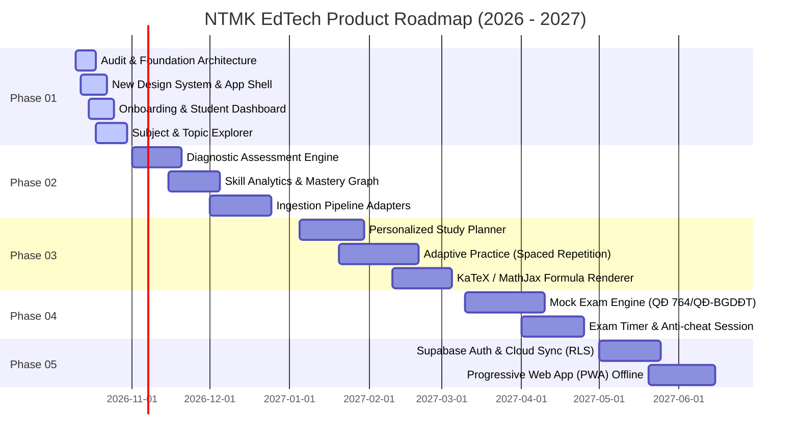

# NTMK REBUILD — LỘ TRÌNH PHÁT TRIỂN SẢN PHẨM (PRODUCT ROADMAP)
**Tài liệu:** `docs/rebuild/03-roadmap.md`  
**Dự án:** NTMK — Nền tảng Ôn Tập Thông Minh  
**Phiên bản kế hoạch:** 2.0 (Chương trình GDPT 2018)  
**Phạm vi:** Kế hoạch tổng thể 5 giai đoạn phát triển từ Foundation đến Intelligent Adaptive Platform

---

## 1. TỔNG QUAN CÁC GIAI ĐOẠN

---

## 2. CHI TIẾT CÁC GIAI ĐOẠN

### GIAI ĐOẠN 01 (PHASE 01) — NỀN TẢNG KIẾN TRÚC & TRẢI NGHIỆM CỐT LÕI (HIỆN TẠI)
*Mục tiêu: Thiết lập nền móng kỹ thuật vững chắc, giải quyết triệt để lỗi server crash, xây dựng Design System đẳng cấp và luồng Onboarding/Dashboard trung thực.*

- [x] **Repository Audit toàn diện**: Thẩm định toàn bộ mã nguồn, cấu hình Vercel, Supabase, các module legacy, bảo mật và hiệu năng.
- [x] **Kiến trúc chuyển đổi từng bước (ADR 001)**: Quyết định phương án Strangler Fig Pattern, giữ nguyên độ tương thích và không làm hỏng deployment.
- [x] **Thiết kế Design System mới**: Xây dựng bảng Design Tokens (Blue/Indigo + Teal), Dark/Light mode, typography tiếng Việt, hỗ trợ A11y và giảm tải video nặng.
- [x] **App Shell & Navigation Router**: Điều hướng các màn hình, responsive hoàn chỉnh trên Mobile, Tablet, Desktop.
- [x] **Luồng Onboarding**: Học sinh lựa chọn Khối lớp (10, 11, 12), Môn học quan tâm (Toán, Vật lí, Hóa học, Tiếng Anh), Mục tiêu học tập (Điểm 8+, Tốt nghiệp, Đánh giá năng lực). Lưu trữ bền vững trong `localStorage`.
- [x] **Student Dashboard trung thực**: Hiển thị thông tin cá nhân hóa, lộ trình học, số liệu thật (không dùng mock progress 150 câu giả tạo).
- [x] **Subject & Topic Explorer**: Khám phá 4 môn học trọng tâm theo 3 khối lớp; hiển thị rõ ràng nhãn trạng thái khả dụng ("Sẵn sàng", "Đang biên soạn", "Chưa sẵn sàng").
- [x] **Bảo toàn tính tương thích**: Phòng thi thử, flashcard và ngân hàng câu hỏi Lịch sử 10, Sinh 10, Tin 10 vẫn hoạt động trơn tru. Sửa lỗi Express crash khi thiếu Supabase ENV.
- [x] **Bộ kiểm thử tự động (Automated Test Suite)**: Xác minh Onboarding state, Subject filtering, API contract integrity.

---

### GIAI ĐOẠN 02 (PHASE 02) — ĐÁNH GIÁ NĂNG LỰC ĐẦU VÀO & PHÂN TÍCH KỸ NĂNG (DIAGNOSTIC & ANALYTICS)
*Mục tiêu: Định vị chính xác lỗ hổng kiến thức của học sinh qua bài test ngắn và lập bản đồ cây kỹ năng.*

- [ ] **Diagnostic Assessment Engine**:
  - Bài kiểm tra chẩn đoán 15–20 câu đa cấp độ nhận thức (Nhận biết, Thông hiểu, Vận dụng).
  - Tự động phân nhánh độ khó theo phản hồi câu hỏi (Basic branching logic).
- [ ] **Skill Knowledge Graph**:
  - Mô hình hóa quan hệ kỹ năng phụ thuộc (Prerequisite skills).
  - Phân tích tỷ lệ thành thạo (Mastery Percentage) cho từng chương mục.
- [ ] **Ingestion Pipeline MVP**:
  - Xây dựng HTTP Source Adapter cho các nguồn dữ liệu giáo dục mở.
  - Parser trích xuất công thức và câu hỏi kiểm định GDPT 2018.

---

### GIAI ĐOẠN 03 (PHASE 03) — LỘ TRÌNH CÁ NHÂN HÓA & LUYỆN TẬP THÍCH ỨNG (ADAPTIVE PRACTICE)
*Mục tiêu: Đưa học sinh vào chu trình luyện tập lặp lại ngắt quãng (Spaced Repetition), khắc phục điểm yếu.*

- [ ] **Personalized Study Planner**:
  - Thuật toán sinh nhiệm vụ học tập hàng ngày dựa trên mục tiêu điểm số và ngày thi dự kiến.
- [ ] **Adaptive Practice Workspace**:
  - Áp dụng giải thuật Spaced Repetition (SuperMemo SM-2 / Leitner modified).
  - Tự động gợi ý câu hỏi cùng dạng khi học sinh làm sai 2 lần liên tiếp.
- [ ] **Math & Chemical Formula Engine**:
  - Tích hợp KaTeX nhẹ, render công thức Toán học và phương trình Hóa học mượt mà trên mobile mà không giật khung hình.

---

### GIAI ĐOẠN 04 (PHASE 04) — THI THỬ CHUẨN ĐỀ BỘ GD&ĐT (MOCK EXAM ENGINE)
*Mục tiêu: Cung cấp trải nghiệm phòng thi trực tuyến áp lực thực tế theo Quyết định 764/QĐ-BGDĐT.*

- [ ] **Cấu hình đề thi chuẩn định dạng GDPT 2018**:
  - **Toán**: 12 trắc nghiệm nhiều lựa chọn + 4 nhóm Đúng/Sai (16 ý) + 6 câu trả lời ngắn (90 phút).
  - **Vật lí**: 18 trắc nghiệm nhiều lựa chọn + 4 nhóm Đúng/Sai (16 ý) + 6 câu trả lời ngắn (50 phút).
  - **Hóa học**: 18 trắc nghiệm nhiều lựa chọn + 4 nhóm Đúng/Sai (16 ý) + 6 câu trả lời ngắn (50 phút).
  - **Tiếng Anh**: 40 trắc nghiệm nhiều lựa chọn (50 phút).
- [ ] **Exam Room Shield**:
  - Phát hiện mất kết nối mạng, tự động lưu bài thi vào bộ nhớ cục bộ và gửi lại khi online.
  - Cảnh báo chuyển tab hoặc mất tiêu điểm màn hình.
- [ ] **Báo cáo phân tích sau thi (Post-Exam Report)**:
  - Phân tích chi tiết thời gian trung bình mỗi câu.
  - Ma trận so sánh với phổ điểm mục tiêu.

---

### GIAI ĐOẠN 05 (PHASE 05) — ĐỒNG BỘ ĐÁM MÂY & MỞ RỘNG CỘNG ĐỒNG (CLOUD SYNC & COMMUNITY)
*Mục tiêu: Đồng bộ đa thiết bị, hỗ trợ ngoại tuyến PWA và tích hợp quản lý tự động.*

- [ ] **Supabase Authentication & Row Level Security (RLS)**:
  - Đăng nhập qua Google / Email / Discord.
  - Mã hóa và bảo vệ tiến độ học sinh qua RLS policy.
- [ ] **Progressive Web App (PWA)**:
  - Khả năng cài đặt vào màn hình chính điện thoại (Add to Home Screen).
  - Service Worker cache ngân hàng câu hỏi để học ngoại tuyến hoàn toàn khi không có mạng.
- [ ] **Automated Question Syncing**:
  - Tự động kiểm tra và đồng bộ câu hỏi từ các nguồn mở định kỳ hàng tuần mà không cần admin tải file thủ công.
