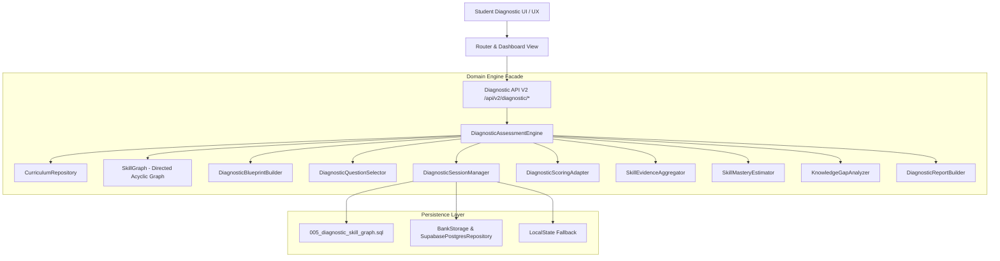

# 31 — KIẾN TRÚC TỔNG THỂ HỆ THỐNG ĐÁNH GIÁ NĂNG LỰC CHẨN ĐOÁN (PHASE 03A ARCHITECTURE)

**Thời điểm:** 11 Tháng 10, 2026 (Asia/Saigon)  
**Tác giả:** Principal EdTech Architect, Assessment Scientist, Learning Analytics Engineer & Senior Full-Stack Engineer  
**Repository:** `Ontap-main`  
**Giai đoạn:** Phase 03A — Intelligent Diagnostic Assessment, Skill Knowledge Graph & Learning Analytics  

---

## 1. MỤC TIÊU VÀ RANH GIỚI HỆ THỐNG (SYSTEM SCOPE & BOUNDARIES)

Hệ thống Đánh giá Năng lực Chẩn đoán (Diagnostic Assessment System) được xây dựng nhằm mục đích cung cấp cho học sinh THPT (Lớp 10, 11, 12) một công cụ khoa học, minh bạch và chính xác để xác định:
1. Những kỹ năng kiến thức đã nắm vững (**Strengths / Proficient / Strong**).
2. Những lỗ hổng kiến thức cốt lõi cần ưu tiên ôn luyện (**Knowledge Gaps / Needs Foundation**).
3. Những kỹ năng tiên quyết liên khối (Cross-grade prerequisites) đang cản trở việc tiếp thu các chủ đề nâng cao.

### Ranh giới thiết kế (Architectural Boundaries)
- **Tách biệt Đánh giá Chẩn đoán và Thi Tốt nghiệp Chính thức:** Bài đánh giá chẩn đoán (15–25 câu) là một bài lấy mẫu trọng tâm (diagnostic sampling), **tuyệt đối không tự nhận là đề thi tốt nghiệp THPT chuẩn hóa** và không tự tiện ngoại suy điểm số tốt nghiệp giả định khi chưa có mô hình IRT chuẩn hóa được hiệu chuẩn (calibrated).
- **Mô hình Năng lực Xác định & Giải thích được:** Từ chối các mô hình AI ngôn ngữ tự gán phần trăm vô căn cứ ("87.43% thành thạo"); thay vào đó áp dụng mô hình Bayes Beta-Binomial với trọng số mức độ nhận thức (cognitive level weighting), khoảng tin cậy (credible interval), và nguyên tắc **Insufficient Evidence Threshold** (ngưỡng tối thiểu bằng chứng).
- **Tách biệt Chuẩn Chương trình và Phân phối Sách giáo khoa:** Chuẩn kiến thức được mô hình hóa theo [Chương trình GDPT 2018](file:///c:/Users/Administrator/Documents/Ontap-main/engine/diagnostic/curriculum-taxonomy-data.js) của Bộ Giáo dục & Đào tạo, độc lập với việc phân chia bài học của từng bộ sách (KNTT, Cánh Diều, Chân Trời Sáng Tạo).

---

## 2. KIẾN TRÚC PHÂN TẦNG VÀ CÁC MODULE CỐT LÕI (LAYERED ARCHITECTURE)

Hệ thống được thiết kế theo mô hình Clean Layered Architecture độc lập với UI, cho phép thực thi trơn tru trên Node.js Express server, Vercel Serverless Functions, hoặc local development:

### Danh mục Module và Trách nhiệm:

| Module | File liên kết | Trách nhiệm chính |
|---|---|---|
| **Curriculum Taxonomy** | [`engine/diagnostic/curriculum-taxonomy-data.js`](file:///c:/Users/Administrator/Documents/Ontap-main/engine/diagnostic/curriculum-taxonomy-data.js) | Cấu trúc phân loại kỹ năng Toán, Vật lí, Hóa học, Tiếng Anh (Lớp 10, 11, 12). |
| **Curriculum Repository** | [`engine/diagnostic/curriculum-repository.js`](file:///c:/Users/Administrator/Documents/Ontap-main/engine/diagnostic/curriculum-repository.js) | Truy vấn kỹ năng, lọc theo khối, môn, topic; ánh xạ phân phối SGK (KNTT, CD, CTST). |
| **Skill Knowledge Graph** | [`engine/diagnostic/skill-graph.js`](file:///c:/Users/Administrator/Documents/Ontap-main/engine/diagnostic/skill-graph.js) | Đồ thị có hướng phi chu trình (DAG), phát hiện chu trình (DFS 3 màu), duyệt cây tiên quyết liên khối. |
| **Blueprint Builder** | [`engine/diagnostic/diagnostic-blueprint-builder.js`](file:///c:/Users/Administrator/Documents/Ontap-main/engine/diagnostic/diagnostic-blueprint-builder.js) | Tạo ma trận bài đánh giá theo khối lớp (45m, 15-25 câu) và bài Sẵn sàng Tốt nghiệp (50m, 20-30 câu). |
| **Question Selector** | [`engine/diagnostic/diagnostic-question-selector.js`](file:///c:/Users/Administrator/Documents/Ontap-main/engine/diagnostic/diagnostic-question-selector.js) | Lọc câu hỏi verified, đối chiếu ma trận kỹ năng, chống lặp câu, và ngắt mạch (fail-closed) khi thiếu câu hỏi. |
| **Session Manager** | [`engine/diagnostic/diagnostic-session-manager.js`](file:///c:/Users/Administrator/Documents/Ontap-main/engine/diagnostic/diagnostic-session-manager.js) | Quản lý phiên làm bài, bóc tách đáp án (student projection), tự động lưu bài (auto-save), khôi phục timer khi reload, nộp bài idempotent. |
| **Scoring Adapter** | [`engine/diagnostic/diagnostic-scoring-adapter.js`](file:///c:/Users/Administrator/Documents/Ontap-main/engine/diagnostic/diagnostic-scoring-adapter.js) | Tích hợp ScoringEngine (QĐ 764/BGDĐT), chấm điểm MCQ, TF Group và Short Answer; phát sinh hồ sơ bằng chứng kỹ năng (skill evidence). |
| **Evidence Aggregator** | [`engine/diagnostic/skill-evidence-aggregator.js`](file:///c:/Users/Administrator/Documents/Ontap-main/engine/diagnostic/skill-evidence-aggregator.js) | Tổng hợp bằng chứng câu hỏi theo từng `skillId` qua nhiều lượt kiểm tra và phân tích theo mức độ nhận thức. |
| **Mastery Estimator** | [`engine/diagnostic/skill-mastery-estimator.js`](file:///c:/Users/Administrator/Documents/Ontap-main/engine/diagnostic/skill-mastery-estimator.js) | Mô hình Bayes Beta-Binomial ước lượng mức độ thành thạo, ngưỡng tin cậy, và phân loại trạng thái năng lực. |
| **Knowledge Gap Analyzer**| [`engine/diagnostic/knowledge-gap-analyzer.js`](file:///c:/Users/Administrator/Documents/Ontap-main/engine/diagnostic/knowledge-gap-analyzer.js) | Phát hiện lỗ hổng kiến thức, truy vết nguyên nhân tiên quyết upstream, và xếp hạng ưu tiên củng cố. |
| **Report Builder** | [`engine/diagnostic/diagnostic-report-builder.js`](file:///c:/Users/Administrator/Documents/Ontap-main/engine/diagnostic/diagnostic-report-builder.js) | Đóng gói báo cáo kết quả chi tiết, biểu đồ năng lực và khuyến nghị hành động cho Phase 03B. |
| **Unified Facade** | [`engine/diagnostic/diagnostic-assessment-engine.js`](file:///c:/Users/Administrator/Documents/Ontap-main/engine/diagnostic/diagnostic-assessment-engine.js) | Lớp giao diện tổng thể kết nối các dịch vụ, cung cấp API thống nhất cho backend và UI. |

---

## 3. LUỒNG DỮ LIỆU ĐÁNH GIÁ (DIAGNOSTIC DATA FLOW)

1. **Chuẩn bị (Readiness Gate):** UI gọi `GET /api/v2/diagnostic/readiness`. Selector kiểm tra ngân hàng câu hỏi. Nếu số lượng câu hỏi verified không đủ ma trận, hệ thống trả về `ready: false` kèm danh sách chi tiết các kỹ năng bị thiếu (`shortages`), từ chối mở bài thi chính thức.
2. **Khởi tạo Phiên (Session Initialization):** Học sinh chọn môn, khối lớp và mục tiêu. Session Manager tạo phiên thi, sinh token bảo mật mã hóa SHA-256, và gửi về Client một bản sao **đã bóc tách 100% đáp án, lời giải và giải thích**.
3. **Làm bài & Tự động Lưu (Auto-Save Workspace):** Client gửi định kỳ các câu trả lời đang chọn lên `POST /api/v2/diagnostic/save-answers`. Nếu học sinh tải lại trang (reload) hoặc đổi thiết bị, `POST /api/v2/diagnostic/resume` khôi phục đầy đủ tiến độ và thời gian còn lại.
4. **Nộp bài & Chấm điểm Server-side (Authoritative Scoring):** Client gửi đáp án lên `POST /api/v2/diagnostic/submit`. Server chấm điểm độc lập qua ScoringAdapter; mọi dữ liệu điểm do Client gửi lên đều bị bỏ qua (anti-tampering). Kết quả được lưu idempotent.
5. **Ước lượng Năng lực & Phân tích Lỗ hổng:** Toàn bộ bằng chứng làm bài được đưa vào `SkillEvidenceAggregator` và `SkillMasteryEstimator` để tính phân phối hậu nghiệm Beta-Binomial. `KnowledgeGapAnalyzer` truy vết cây kỹ năng tiên quyết để chỉ ra nguyên nhân gốc rễ và đưa ra khuyến nghị ôn tập.

---

## 4. CHIẾN LƯỢC BẢO MẬT & TOÀN VẸN DỮ LIỆU (SECURITY & INTEGRITY)

- **Answer Key Concealment:** Tuyệt đối không để lộ trường `correctOptionIndex`, `correctAnswer`, `acceptedAnswers`, `statements[].correct` hay `explanation` trước khi học sinh nộp bài.
- **Idempotency Guarantee:** Nộp bài nhiều lần cùng một `sessionId` trả về nguyên vẹn bản ghi đánh giá đã lưu lần đầu, ngăn chặn việc tính điểm lặp lại hoặc thao túng thời gian nộp bài.
- **Student Ownership & Privilege Separation:** Token phiên làm bài được lưu trữ dưới dạng băm SHA-256; học sinh A không thể truy vấn hoặc nộp bài thay học sinh B.
- **Fail-Closed Storage Fallback:** Khi kết nối cơ sở dữ liệu gặp sự cố, hệ thống chuyển sang chế độ an toàn có thông báo rõ ràng, không làm gián đoạn bài làm đang lưu cục bộ của học sinh.
