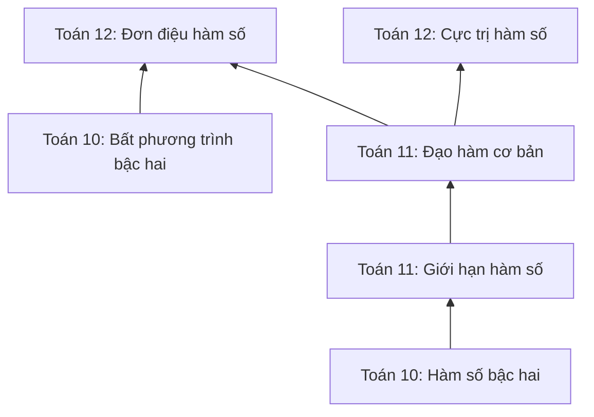

# 32 — ĐỒ THỊ TRI THỨC KỸ NĂNG CHƯƠNG TRÌNH GDPT 2018 (CURRICULUM SKILL KNOWLEDGE GRAPH)

**Thời điểm:** 11 Tháng 10, 2026 (Asia/Saigon)  
**Tác giả:** Principal EdTech Architect & Assessment Scientist  
**Repository:** `Ontap-main`  
**File nguồn chính:** [`engine/diagnostic/curriculum-taxonomy-data.js`](file:///c:/Users/Administrator/Documents/Ontap-main/engine/diagnostic/curriculum-taxonomy-data.js), [`engine/diagnostic/curriculum-repository.js`](file:///c:/Users/Administrator/Documents/Ontap-main/engine/diagnostic/curriculum-repository.js), [`engine/diagnostic/skill-graph.js`](file:///c:/Users/Administrator/Documents/Ontap-main/engine/diagnostic/skill-graph.js)  

---

## 1. PHÂN CẤP TRI THỨC KHOA HỌC (TAXONOMY HIERARCHY)

Hệ thống phân cấp kỹ năng tuân thủ nghiêm ngặt chuẩn giáo dục quốc gia, phân biệt rạch ròi giữa mục tiêu chương trình cốt lõi và các bố cục sách giáo khoa cụ thể:

```
Môn học (Subject: toan, vatli, hoahoc, tienganh)
 └── Khối lớp (Grade: 10, 11, 12)
      └── Miền kiến thức (Domain: Đại số, Hình học, Cơ học, Hóa vô cơ, v.v.)
           └── Chủ đề / Chương (Topic: Mệnh đề - Tập hợp, Khảo sát hàm số, v.v.)
                └── Kỹ năng đơn nguyên (Skill: math-12-func-monotonicity)
                     └── Kỹ năng tiên quyết (Prerequisites: math-11-derivatives, math-10-quad-ineq)
```

### Quy ước Định danh Ổn định (Stable ID Conventions)
Mọi node kỹ năng đều có ID bất biến theo mẫu: `[subject]-[grade]-[kebab-case-slug]`. Ví dụ:
- `math-10-sets-logic`: Mệnh đề toán học và phép toán tập hợp (Toán 10)
- `math-11-derivatives`: Đạo hàm & Ý nghĩa hình học của đạo hàm (Toán 11)
- `math-12-func-monotonicity`: Tính đơn điệu của hàm số (Toán 12)
- `phys-10-motion-kinematics`: Chuyển động thẳng biến đổi đều (Vật lí 10)
- `phys-11-simple-harmonic-motion`: Dao động điều hòa (Vật lí 11)
- `phys-12-gas-laws`: Thuyết động học phân tử chất khí & Các định luật chất khí (Vật lí 12)
- `chem-10-atomic-structure`: Cấu tạo nguyên tử & Bảng tuần hoàn (Hóa học 10)
- `chem-11-chemical-equilibrium`: Cân bằng hóa học & pH dung dịch (Hóa học 11)
- `chem-12-ester-lipid`: Ester & Lipid (Hóa học 12)
- `eng-10-tenses-aspect`: Hệ thống thì động từ cốt lõi (Tiếng Anh 10)
- `eng-11-relative-clauses`: Mệnh đề quan hệ & Mệnh đề rút gọn (Tiếng Anh 11)
- `eng-12-reading-main-idea`: Kỹ năng đọc hiểu — Ý chính & Suy luận (Tiếng Anh 12)

---

## 2. PHÂN TÁCH CHUẨN CHƯƠNG TRÌNH VÀ BỘ SÁCH GIÁO KHOA (CURRICULUM VS TEXTBOOK MAPPING)

- **Chuẩn Quốc gia (National Standard):** Chương trình GDPT 2018 ban hành kèm Thông tư 32/2018/TT-BGDĐT là khung pháp lý duy nhất định hình yêu cầu cần đạt (learning objectives) của học sinh trên cả nước.
- **Ánh xạ Bộ SGK (Textbook Series):** Các bộ sách giáo khoa (Kết nối tri thức với cuộc sống - KNTT, Cánh Diều - CD, Chân trời sáng tạo - CTST) chỉ là tài liệu tham khảo cụ thể hóa chương trình. Thứ tự bài học hoặc cách gom cụm chủ đề có thể khác nhau giữa các sách, nhưng các kỹ năng cốt lõi là tương đương.
- Module [`CurriculumRepository.getTextbookMapping(skillId, textbookSeries)`](file:///c:/Users/Administrator/Documents/Ontap-main/engine/diagnostic/curriculum-repository.js) cho phép học sinh hoặc giáo viên đối chiếu kỹ năng chuẩn sang chương/bài của bộ sách mình đang học mà không làm thay đổi ID kỹ năng hay phá vỡ đồ thị tri thức.

---

## 3. MÔ HÌNH ĐỒ THỊ CÓ HƯỚNG PHI CHU TRÌNH (DAG) VÀ PHÁT HIỆN CHU TRÌNH

Đồ thị tri thức được mô hình hóa dưới dạng **Directed Acyclic Graph (DAG)**:
- Mỗi node là một kỹ năng ($S_i$).
- Mỗi cạnh có hướng $S_i \to S_j$ thể hiện $S_j$ là kỹ năng tiên quyết trực tiếp của $S_i$ ($S_j \in \text{Prerequisites}(S_i)$).



### Thuật toán kiểm tra toàn vẹn đồ thị (DAG Integrity Check)
Module [`SkillGraph.validateGraph()`](file:///c:/Users/Administrator/Documents/Ontap-main/engine/diagnostic/skill-graph.js) áp dụng thuật toán DFS với 3 trạng thái màu sắc:
- `0 (White / Unvisited):` Node chưa duyệt.
- `1 (Gray / Visiting):` Node đang nằm trong stack đệ quy hiện tại. Nếu duyệt trúng một node màu Gray, chu trình được phát hiện ngay lập tức.
- `2 (Black / Visited):` Node đã duyệt hoàn tất toàn bộ cây con.

**Kết quả kiểm tra thực tế:**
- Tổng số kỹ năng đã đối chiếu chương trình: **48 kỹ năng cốt lõi** trên 4 môn học và 3 khối lớp.
- Số chu trình phát hiện: **0** (`hasCycle: false, cyclePath: null`).
- Số kỹ năng tiên quyết mồ côi (orphaned references): **0** (`orphanedPrerequisites: []`).
- Trạng thái kiểm tra: **DAG HỢP LỆ TUYỆT ĐỐI (100% VALID)**.

---

## 4. QUAN HỆ TIÊN QUYẾT LIÊN KHỐI (CROSS-GRADE PREREQUISITE TRAVERSAL)

Học sinh lớp 12 khi gặp khó khăn với bài toán Khảo sát hàm số nâng cao thường không phải do không hiểu định nghĩa lớp 12, mà do hổng kỹ năng tính đạo hàm của lớp 11 hoặc kỹ năng giải bất phương trình bậc hai của lớp 10.

Hàm [`SkillGraph.getPrerequisites(skillId, { recursive: true, crossGradeOnly: true })`](file:///c:/Users/Administrator/Documents/Ontap-main/engine/diagnostic/skill-graph.js) tự động duyệt ngược cây phụ thuộc và bóc tách các kỹ năng thuộc khối lớp trước:

```javascript
// Ví dụ: math-12-func-monotonicity
const crossGradePrereqs = graph.getPrerequisites('math-12-func-monotonicity', {
  recursive: true,
  crossGradeOnly: true
});
// Kết quả trả về:
// 1. math-11-derivatives (Lớp 11: Đạo hàm)
// 2. math-11-limits-continuity (Lớp 11: Giới hạn hàm số)
// 3. math-10-quad-func (Lớp 10: Hàm số bậc hai)
// 4. math-10-quad-ineq (Lớp 10: Bất phương trình bậc hai)
```

---

## 5. THUẬT TOÁN CHẨN ĐOÁN LỖ HỔNG TIÊN QUYẾT (PREREQUISITE GAP DIAGNOSIS)

Khi học sinh làm sai một câu hỏi thuộc kỹ năng nâng cao (ví dụ Lớp 12), hệ thống không vội vàng kết luận học sinh "kém toàn diện" mà kích hoạt thuật toán chẩn đoán [`diagnosePrerequisiteGaps(failedSkillId, masteryMap)`](file:///c:/Users/Administrator/Documents/Ontap-main/engine/diagnostic/skill-graph.js):

1. **Nếu kỹ năng tiên quyết chưa từng được làm bài (`not_assessed`):**
   - Đánh dấu trạng thái: `untested_suspect`.
   - Khuyến nghị: *"Đề xuất kiểm tra bổ trợ kỹ năng tiên quyết lớp [Grade] trước khi học tiếp."*
2. **Nếu kỹ năng tiên quyết đã được kiểm tra và có kết quả yếu (`needs_foundation`):**
   - Đánh dấu trạng thái: `confirmed_prerequisite_gap`.
   - Khuyến nghị: *"Ưu tiên củng cố kỹ năng nền tảng [Grade]: [Title]."*
3. **Nếu kỹ năng tiên quyết đã thành thạo (`proficient` hoặc `strong`):**
   - Đánh dấu trạng thái: `prerequisite_mastered`.
   - Khuyến nghị: *"Kỹ năng nền tảng đã vững; lỗi sai có thể do kỹ năng tư duy vận dụng hoặc kỹ thuật tính toán bài toán nâng cao."*
