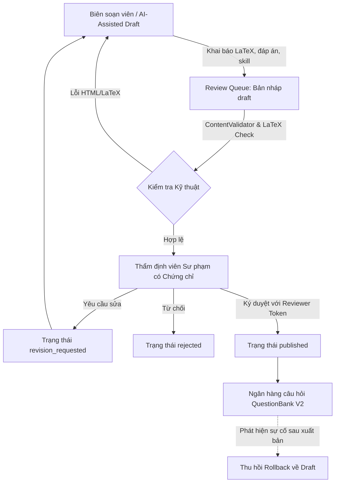

# NTMK REBUILD — CHIẾN LƯỢC NGUỒN HỌC LIỆU VÀ QUY TRÌNH BIÊN SOẠN THẬT (PHASE 04A)

> **Tài liệu:** `docs/rebuild/45-real-content-source-strategy.md`  
> **Phiên bản:** Phase 04A Real Content Strategy  
> **Thời điểm thẩm định:** 12/10/2026  
> **Trạng thái:** `INTERNAL AUTHORING OPERATIONAL` | `EXTERNAL LIVE SOURCES = BLOCKED`

---

## 1. TỔNG QUAN VẤN ĐỀ NỘI DUNG TẠI NTMK

Sự thiếu hụt câu hỏi ôn tập có bản quyền và được thẩm định sư phạm là rào cản lớn nhất (primary blocker) đối với việc phát hành công khai NTMK.
Để giải quyết bài toán này một cách bền vững, NTMK triển khai chiến lược hai luồng nội dung song song (Two-Pronged Content Strategy):
1. **Luồng A (Licensed External Sources):** Kết nối nguồn học liệu mở / được cấp phép.
2. **Luồng B (Original NTMK Question Bank):** Quy trình biên soạn, kiểm duyệt và xuất bản câu hỏi gốc.

---

## 2. LUỒNG A — KHẢO SÁT VÀ ĐÁNH GIÁ NGUỒN NGOÀI (EXTERNAL SOURCES)

### 2.1. Tiêu chí kiểm định pháp lý và kỹ thuật
Mỗi nguồn bên ngoài được đánh giá khắt khe qua 11 tiêu chí:
1. URL và Endpoint xác thực.
2. Giao diện tích hợp (API chuẩn hoặc dữ liệu có cấu trúc).
3. Độ phủ môn học (Toán, Vật lí, Hóa học, Tiếng Anh).
4. Độ phủ khối lớp (Lớp 10, 11, 12).
5. Cấu trúc câu hỏi tương thích GDPT 2018 (MCQ, Đúng/Sai đa ý, Trả lời ngắn).
6. Có đáp án chính thức và giải thích chi tiết.
7. Giấy phép bản quyền (Creative Commons CC-BY, CC-BY-SA, hoặc thỏa thuận ủy quyền tái sử dụng).
8. Quyền tái xuất bản và lưu trữ cơ sở dữ liệu.
9. Yêu cầu ghi công (Attribution requirements).
10. Giới hạn tần suất truy vấn (Rate limits).
11. Quyền chuyển đổi định dạng và công thức (LaTeX).

### 2.2. Kết quả rà soát hiện tại
- **Các trang web đề thi công khai trên Internet:** Mặc dù mã nguồn có thể trả về HTTP 200 và robots.txt không cấm, các trang này **hoàn toàn không có giấy phép cho phép tái xuất bản cơ sở dữ liệu**. Việc cào dữ liệu từ các trang này vi phạm quyền tác giả và tiềm ẩn rủi ro pháp lý nghiêm trọng.
- **Quyết định kiến trúc:** NTMK tiếp tục duy trì trạng thái **`EXTERNAL SOURCES = BLOCKED`** trong Ingestion Source Registry. Hệ thống không cho phép bất kỳ connector nào tự ý cào dữ liệu hoặc vượt qua cơ chế bảo vệ.

---

## 3. LUỒNG B — QUY TRÌNH BIÊN SOẠN CÂU HỎI GỐC NTMK (ORIGINAL QUESTION BANK)

Nhằm đảm bảo 100% tính hợp pháp và chất lượng học thuật, NTMK triển khai hệ thống biên soạn nội bộ hoàn chỉnh thông qua API và Review Console:

### 3.1. Các tính năng cốt lõi đã hoàn thiện
1. **Endpoint `POST /api/v2/admin/questions/draft`:**
   - Cho phép biên soạn viên nhập câu hỏi mới với công thức LaTeX chuẩn ($...$).
   - Đánh dấu cờ `isAiAssisted` nếu có sự trợ giúp của AI trong việc đề xuất bản nháp (AI-assisted drafts tuyệt đối không được coi là đã xác minh).
2. **Endpoint `POST /api/v2/admin/questions/revision`:**
   - Thẩm định viên yêu cầu biên soạn viên chỉnh sửa câu hỏi với lý do sư phạm cụ thể (`revisionNote`).
3. **Endpoint `POST /api/v2/admin/questions/rollback`:**
   - Cho phép thu hồi tức thì câu hỏi đã xuất bản về trạng thái bản nháp nếu phát hiện sai sót kiến thức.
4. **Pedagogical Verification Gate:**
   - Câu hỏi chỉ được chuyển sang `published` khi có chữ ký và token của thẩm định viên chuyên môn có chứng chỉ sư phạm trong `ReviewerDirectory`.

---

## 4. BẢO VỆ CHỐNG RÒ RỈ ĐÁP ÁN (ANSWER-KEY SANITIZATION)

Để đảm bảo tính nghiêm túc trong luyện tập và kiểm tra:
- Hàm `QuestionSanitizer.sanitizeForStudent()` được kích hoạt bắt buộc trên toàn bộ các route công khai.
- Khi học sinh làm bài: Các trường `correctAnswer`, `correctAnswerPolicy`, `explanation` và `rubric` bị tước bỏ hoàn toàn ở tầng server trước khi gửi JSON về trình duyệt.
- Điểm số được tính toán Authoritative trên server thông qua `ScoringAdapter`.
