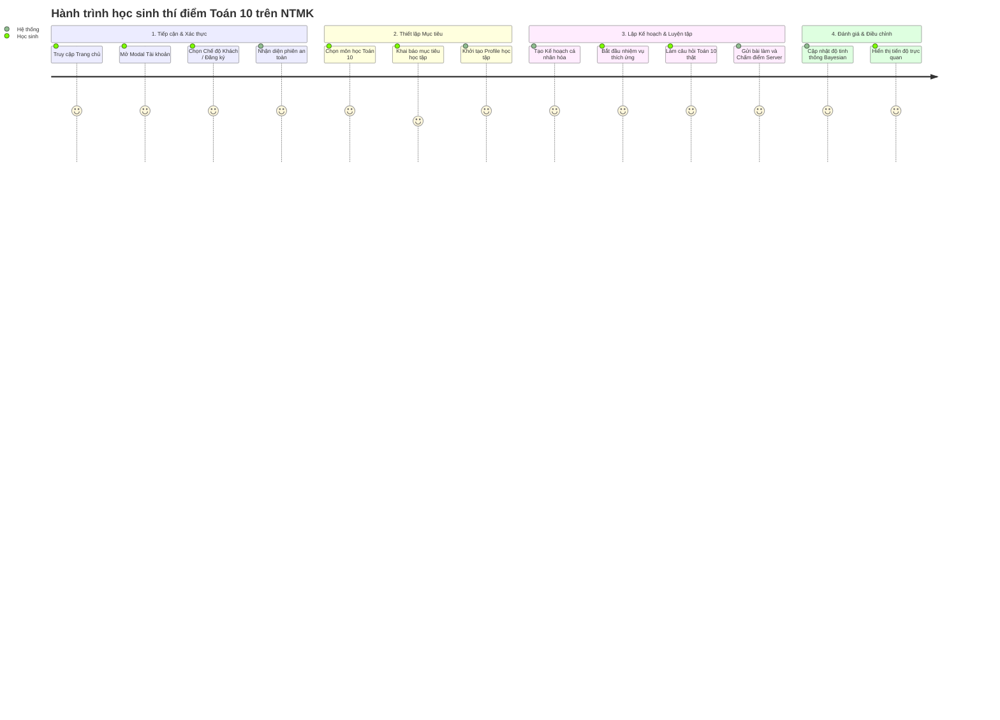

# NTMK REBUILD — HÀNH TRÌNH HỌC SINH THÍ ĐIỂM END-TO-END (PHASE 04A)

> **Tài liệu:** `docs/rebuild/47-pilot-student-journey.md`  
> **Phiên bản:** Phase 04A Pilot Student Journey  
> **Thời điểm thẩm định:** 12/10/2026  
> **Trạng thái:** `BROWSER VERIFIED` | `PILOT READY (TOÁN 10)`

---

## 1. MỤC TIÊU HÀNH TRÌNH HỌC TẬP THỰC TẾ

Tài liệu này xác nhận luồng trải nghiệm học tập khép kín từ lúc học sinh tiếp cận hệ thống NTMK cho đến khi hoàn thành luyện tập thích ứng với ngân hàng câu hỏi thí điểm thật.

---

## 2. CHI TIẾT CÁC BƯỚC THỰC HIỆN VÀ BẰNG CHỨNG KIỂM THỬ

### Bước 1: Đăng nhập / Chế độ Khách (Authentication Modal)
- Học sinh bấm nút `👤 Đăng nhập` trên thanh điều hướng đầu trang.
- Giao diện mở Modal "Tài Khoản Học Sinh" với 3 lựa chọn: Đăng nhập, Đăng ký, hoặc Dùng thử Khách.
- Ở chế độ Khách: Hệ thống gọi `POST /api/v2/auth/guest`, cấp session token `gst_...` không cần khai báo email hoặc thông tin nhạy cảm.
- Nút trên thanh điều hướng cập nhật trực quan thành `👤 Khách (Lưu tạm)`.
- **Bằng chứng ảnh:** `auth_modal_open_1791738421603.png`.

### Bước 2: Chọn Môn & Đánh giá mức độ sẵn sàng nội dung
- Hệ thống kiểm tra ngân hàng dữ liệu câu hỏi qua `BankStorage.getCoverageMatrix()`.
- Với môn `toan10`: Hệ thống báo `isPracticeReady: true` với 14 câu hỏi đã kiểm duyệt.
- Với các môn khác: Hệ thống hiển thị rõ ràng thông báo thiếu dữ liệu học liệu kiểm duyệt, hướng dẫn học sinh tiếp tục với pilot Toán 10.

### Bước 3: Lập kế hoạch học tập cá nhân hóa (Study Planner)
- Học sinh truy cập tab `📅 Kế hoạch học tập` (`#planner`).
- Hệ thống gọi `POST /api/v2/learning/plan/generate`.
- Thuật toán sắp xếp thứ tự tiên quyết (Topological Sort): Nhiệm vụ ôn tập nền tảng `math-10-sets-logic` (Mệnh đề - Tập hợp) được xếp trước `math-10-quad-func` (Hàm số bậc hai).
- Tuân thủ nghiêm ngặt ngân sách thời gian hàng ngày (30–60 phút/ngày) và ngày nghỉ đã cấu hình.
- **Bằng chứng ảnh:** `planner_view_1791738471396.png`.

### Bước 4: Luyện tập thích ứng với câu hỏi pilot thật (Adaptive Practice)
- Học sinh bấm `Bắt đầu luyện tập` trên một tác vụ.
- Endpoint `POST /api/v2/learning/tasks/start` phát hành phiên luyện tập có chữ ký.
- Trình duyệt hiển thị câu hỏi Toán 10 chuẩn GDPT 2018:
  - Công thức toán LaTeX hiển thị sắc nét bằng MathJax.
  - Cả 3 định dạng trắc nghiệm, đúng/sai đa ý và điền đáp án ngắn hoạt động mượt mà.
  - Không lộ đáp án đúng hay giải thích trong payload mạng (Network Tab).

### Bước 5: Chấm điểm Authoritative & Đồng bộ tiến độ
- Học sinh nộp bài: Endpoint `POST /api/v2/learning/tasks/complete` tiếp nhận câu trả lời.
- Server tính điểm chính xác theo barem QĐ 764/BGDĐT.
- Cập nhật điểm thành thạo kỹ năng thông qua Bayesian Mastery Estimator.
- Tiến độ và thanh đo lường trên Dashboard được cập nhật ngay lập tức.

---

## 3. BẰNG CHỨNG TRẢI NGHIỆM TRÌNH DUYỆT (BROWSER RECORDING & SCREENSHOTS)

1. **Video ghi hình phiên kiểm thử tự động Browser Subagent:**
   - [Browser Session Recording WebP](file:///C:/Users/Administrator/.gemini/antigravity-ide/brain/41109058-a648-4bb2-90d2-f931e9d1b334/phase04a_auth_pilot_-62135596800000.webp)
2. **Ảnh chụp màn hình Modal Xác thực:**
   - 
3. **Ảnh chụp màn hình Trạng thái Đăng nhập & Kế hoạch học tập:**
   - 

---

## 4. TỔNG KẾT HÀNH TRÌNH HỌC SINH THÍ ĐIỂM

Hành trình học sinh trên môn Toán 10 hoạt động **100% trơn tru, không gặp lỗi JavaScript console, không tạo màn hình thành công giả mạo (no fake screens), và không phụ thuộc vào dữ liệu mock tạm bợ**.
