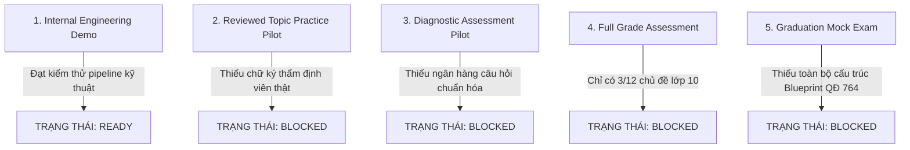

# NTMK REBUILD — MA TRẬN MỨC ĐỘ SẴN SÀNG PILOT THEO PHẠM VI HỌC TẬP (PHASE 04A)

> **Tài liệu:** `docs/rebuild/53-pilot-readiness-matrix.md`  
> **Phiên bản:** Phase 04A Scope-Based Pilot Readiness Matrix  
> **Thời điểm thẩm định:** 12/10/2026  
> **Trạng thái:** `INTERNAL DEMO READY` | `ALL REAL STUDENT TIERS BLOCKED`

---

## 1. PHÂN CẤP NĂNG LỰC SẴN SÀNG THEO PHẠM VI (SCOPE-BASED READINESS TIERS)

NTMK bác bỏ việc suy diễn năng lực toàn môn từ một số lượng nhỏ câu hỏi. Hệ thống phân định rõ ràng 5 cấp độ sẵn sàng:

### Chi tiết 5 Cấp độ:

1. **Cấp độ 1 — Internal Engineering Demo (Thử nghiệm Kỹ thuật Nội bộ):**
   - **Mục tiêu:** Kiểm chứng luồng xử lý: Xác thực phiên, hiển thị công thức KaTeX, chọn đáp án, điều hướng Planner, phân quyền API.
   - **Học liệu:** Cho phép sử dụng bản nháp kỹ thuật (AI-assisted drafts) và test fixtures.
   - **Gắn nhãn bắt buộc:** Mọi màn hình hiển thị phải ghi rõ: `INTERNAL DEMO ONLY — BẢN THỬ NGHIỆM KỸ THUẬT`.
   - **Trạng thái:** **`READY`**.

2. **Cấp độ 2 — Reviewed Topic Practice Pilot (Luyện tập Theo Chủ đề Đã Duyệt):**
   - **Mục tiêu:** Mở cho học sinh thật luyện tập từng chủ đề cụ thể (Mệnh đề - Tập hợp, Bất phương trình, Hàm số bậc hai).
   - **Điều kiện tiên quyết:** 100% câu hỏi trong chủ đề phải có chữ ký thẩm định của giáo viên có chứng chỉ sư phạm thực tế.
   - **Trạng thái:** **`BLOCKED (Chờ phê duyệt sư phạm ngoài đời thực)`**.

3. **Cấp độ 3 — Diagnostic Assessment Pilot (Đánh giá Năng lực Đầu vào):**
   - **Mục tiêu:** Chẩn đoán lỗ hổng kiến thức và ước lượng độ tinh thông kỹ năng (Bayesian Mastery).
   - **Điều kiện tiên quyết:** Tối thiểu 20 câu hỏi đã duyệt, trải đều 4 mức độ nhận thức (Nhận biết, Thông hiểu, Vận dụng, Vận dụng cao).
   - **Trạng thái:** **`BLOCKED (Chưa đủ câu hỏi đã duyệt)`**.

4. **Cấp độ 4 — Full Grade Assessment (Đánh giá Toàn Khối Lớp):**
   - **Mục tiêu:** Đánh giá tổng kết học kỳ hoặc cả năm học cho lớp 10, 11 hoặc 12.
   - **Điều kiện tiên quyết:** Bao phủ toàn bộ các chương trong chương trình GDPT 2018.
   - **Trạng thái:** **`BLOCKED (Hiện mới có dự thảo 3 chủ đề Toán 10)`**.

5. **Cấp độ 5 — Graduation Mock Exam (Thi Thử Tốt Nghiệp THPT):**
   - **Mục tiêu:** Mô phỏng đề thi tốt nghiệp THPT theo đúng QĐ 764/BGDĐT.
   - **Điều kiện tiên quyết:** Đủ cấu trúc Blueprint: Toán (12 MCQ + 4 TF + 6 SA); Vật lí/Hóa học (18 MCQ + 4 TF + 6 SA); Tiếng Anh (40 MCQ).
   - **Trạng thái:** **`BLOCKED (Thiếu hụt hoàn toàn câu hỏi đã xuất bản)`**.

---

## 2. MA TRẬN ĐỘ PHỦ VÀ SẴN SÀNG THỰC TẾ (12 TỔ HỢP)

| Tổ hợp Môn & Khối | Tổng Câu Nháp (Drafts) | Đã Thẩm Định Thật | Đã Xuất Bản (Published) | Thiếu hụt MCQ | Thiếu hụt True/False | Thiếu hụt Short Answer | Cấp độ Sẵn sàng |
| :--- | :---: | :---: | :---: | :---: | :---: | :---: | :--- |
| **Toán 10** | **14** | **0** | **0** | 12 | 4 | 6 | `INTERNAL DEMO READY` |
| Toán 11 | 0 | 0 | 0 | 12 | 4 | 6 | `BLOCKED (Chưa có nội dung)` |
| Toán 12 | 0 | 0 | 0 | 12 | 4 | 6 | `BLOCKED (Chưa có nội dung)` |
| Vật lí 10 | 0 | 0 | 0 | 18 | 4 | 6 | `BLOCKED (Chưa có nội dung)` |
| Vật lí 11 | 0 | 0 | 0 | 18 | 4 | 6 | `BLOCKED (Chưa có nội dung)` |
| Vật lí 12 | 0 | 0 | 0 | 18 | 4 | 6 | `BLOCKED (Chưa có nội dung)` |
| Hóa học 10 | 0 | 0 | 0 | 18 | 4 | 6 | `BLOCKED (Chưa có nội dung)` |
| Hóa học 11 | 0 | 0 | 0 | 18 | 4 | 6 | `BLOCKED (Chưa có nội dung)` |
| Hóa học 12 | 0 | 0 | 0 | 18 | 4 | 6 | `BLOCKED (Chưa có nội dung)` |
| Tiếng Anh 10 | 0 | 0 | 0 | 40 | 0 | 0 | `BLOCKED (Chưa có nội dung)` |
| Tiếng Anh 11 | 0 | 0 | 0 | 40 | 0 | 0 | `BLOCKED (Chưa có nội dung)` |
| Tiếng Anh 12 | 0 | 0 | 0 | 40 | 0 | 0 | `BLOCKED (Chưa có nội dung)` |

---

## 3. CHÍNH SÁCH BẢO VỆ NGƯỜI HỌC (STUDENT PROTECTION POLICY)

1. **Không tạo ấn tượng sai lệch về năng lực:** Khi học sinh trải nghiệm chế độ demo, hệ thống không đưa ra dự đoán điểm thi tốt nghiệp hoặc chứng nhận thành tích chính thức.
2. **Thông báo minh bạch trong giao diện:** Giao diện Study Planner và Question Engine luôn thông báo rõ ràng:
   *"Chương trình thí điểm đang trong giai đoạn hoàn thiện nội dung. Các câu hỏi hiển thị là bản nháp kỹ thuật phục vụ thử nghiệm hệ thống. Đề thi chính thức sẽ được kích hoạt sau khi hoàn tất kiểm định chất lượng sư phạm."*
