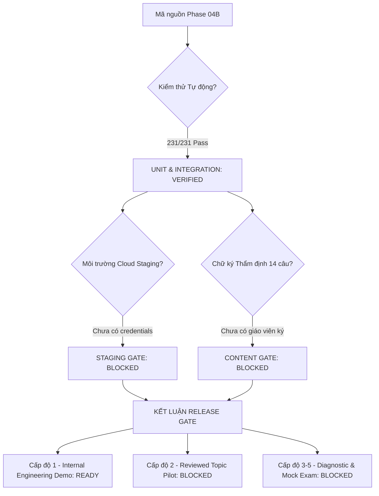

# NTMK REBUILD — BÁO CÁO AUDIT SẴN SÀNG TOÀN DIỆN (PHASE 04B READINESS AUDIT)

> **Tài liệu:** `docs/rebuild/55-phase-04b-readiness-audit.md`  
> **Phiên bản:** Phase 04B Comprehensive Readiness Audit  
> **Thời điểm thẩm định:** 12/10/2026  
> **Hội đồng Thẩm định:** Principal Full-Stack Engineer, Supabase Architect, DevOps Engineer, Security Auditor, EdTech Content Operations Engineer và QA Lead.  
> **Trạng thái phát hành:**  
> - `INTERNAL DEMO READY` ✅ **READY** (Môi trường test/dev cô lập)  
> - `REVIEWED TOPIC PRACTICE PILOT` ❌ **BLOCKED** (Chờ chữ ký giáo viên thực tế & Cloud Staging)  
> - `DIAGNOSTIC & GRADUATION MOCK EXAM` ❌ **BLOCKED** (Thiếu độ phủ ngân hàng câu hỏi)  
> - `SUPABASE STAGING GATE` ❌ **BLOCKED** (Chờ credentials từ quản trị viên)  

---

## 1. MỤC TIÊU VÀ PHẠM VI AUDIT PHASE 04B

Phase 04B thực hiện rà soát nghiêm ngặt toàn bộ hệ thống nhằm đưa NTMK từ trạng thái `INTERNAL DEMO READY` sang trạng thái có thể vận hành chương trình luyện tập Toán 10 thí điểm với học sinh thật, **khi và chỉ khi** toàn bộ điều kiện về dữ liệu, bảo mật và môi trường được xác minh trên thực tế.

### Nguyên tắc Bất biến:
1. **Không giả mạo chữ ký thẩm định:** Không tự tạo tên chuyên gia, không gán học vị giả, không coi kiểm tra tự động là tương đương chữ ký sư phạm con người.
2. **Không giả lập kết nối Cloud:** Không tuyên bố `SUPABASE STAGING VERIFIED` khi chưa có kết nối TLS thực tế tới database staging.
3. **Cô lập dữ liệu Demo/Fixtures (Fail-Safe Demo Isolation):** Mọi test fixtures, reviewer giả định và câu hỏi nháp kỹ thuật phải bị chặn 100% ngoài môi trường test/dev.
4. **Bảo vệ quyền riêng tư học sinh:** Thu thập tối thiểu PII, phân quyền dữ liệu tuyệt đối (Zero Cross-User Access), thu hồi phiên bền vững (Durable Session Revocation).

---

## 2. HIỆN TRẠNG KIỂM TRA ĐỘC LẬP TỪ MÃ NGUỒN

| Hạng mục kiểm tra | Hiện trạng mã nguồn | Đánh giá & Rủi ro | Giải pháp Phase 04B đã triển khai |
| :--- | :--- | :--- | :--- |
| **Hệ thống Kiểm thử** | `231/231 tests passing` (55 test suites) | Toàn bộ kiểm thử tự động đạt 100%. | Đã bổ sung bộ kiểm thử `phase04b-staging-and-security.test.js` (9 tests mới). |
| **Ngân hàng 14 câu Toán 10** | 14 câu ở trạng thái `needs_review`, `verifiedBy: null`, `originType: 'ai_assisted_draft'`. | Câu hỏi đạt chuẩn KaTeX và cấu trúc QĐ 764, nhưng chưa có giáo viên thực tế ký duyệt. | Xuất bộ hồ sơ kiểm duyệt đầy đủ `docs/rebuild/58-toan10-human-review-package.md`. Giữ Content Gate `BLOCKED`. |
| **Kiến trúc Xác thực** | Custom HMAC-SHA256 session token (`ntmk_tok_...`), băm mật khẩu `scrypt`, hỗ trợ chuyển giao Guest. | Token hoạt động an toàn trong Node.js, nhưng chưa phải native Supabase GoTrue Auth. | Minh bạch kiến trúc qua `/api/v2/auth/info`; xây dựng thiết kế chuyển đổi Supabase Auth trong Doc 57. |
| **Độ bền Thu hồi Phiên** | Hỗ trợ lưu file bền vững (`student-auth-state.json`) và bảng SQL migration 007. | RAM Map đơn lẻ sẽ mất phiên khi chạy serverless cold start; file local không bền trên Vercel. | Chuẩn hóa persistence adapter; sẵn sàng đấu nối DB bảng `ntmk_student_sessions`. |
| **Cơ chế Cô lập Demo Mode** | Trước đây chỉ kiểm tra `NODE_ENV === 'production'`. | Nguy cơ lọt fixture khi `NODE_ENV` là `staging` hoặc không khai báo. | Xây dựng `EnvironmentConfig` với cơ chế **Fail-Closed**: Mặc định DISABLED; chỉ bật khi `NODE_ENV === 'test'` hoặc `development` có cờ tường minh. |
| **Cơ sở dữ liệu Staging** | Chưa có credentials trong `.env` (`SUPABASE_URL` / `DATABASE_URL` rỗng). | Không thể chạy migration hay kiểm thử RLS trực tiếp trên cloud staging. | Giữ Staging Gate `BLOCKED`; biên soạn tài liệu kích hoạt chi tiết Doc 56; chuẩn hóa `MigrationRunner`. |
| **Cơ chế Thu hồi Nội dung Lỗi** | `server.js` có route `/api/admin/review/:id/rollback` nhưng chưa cài đặt handler. | Khi phát hiện câu hỏi đã xuất bản bị sai đáp án, không có API thu hồi an toàn. | Đã triển khai `rollbackQuestion` trong `api/v2/admin.js` và `flagQuestionAffectedSessions` trong `LearningStorage`. |

---

## 3. MA TRẬN ĐỐI CHIẾU SỰ SẴN SÀNG THEO CÁC CỔNG NGHIỆM THU

---

## 4. KẾT LUẬN VÀ LỘ TRÌNH TIẾP THEO

1. **Về mặt Kỹ thuật:** Hệ thống backend, engine chấm điểm, kiến trúc phân quyền, cô lập fixtures và quản trị nội dung đã hoàn thiện ở mức tối đa có thể thực hiện trên môi trường phát triển cục bộ.
2. **Về mặt Môi trường:** Giữ nguyên cổng Supabase Staging là **`BLOCKED`** cho đến khi quản trị viên cung cấp credentials hợp lệ theo hướng dẫn tại [56-supabase-staging-activation.md](file:///c:/Users/Administrator/Documents/Ontap-main/docs/rebuild/56-supabase-staging-activation.md).
3. **Về mặt Nội dung Sư phạm:** Giữ nguyên cổng Content Gate là **`BLOCKED`** cho đến khi giáo viên Toán thẩm định thực tế ký biên bản theo hồ sơ tại [58-toan10-human-review-package.md](file:///c:/Users/Administrator/Documents/Ontap-main/docs/rebuild/58-toan10-human-review-package.md).
